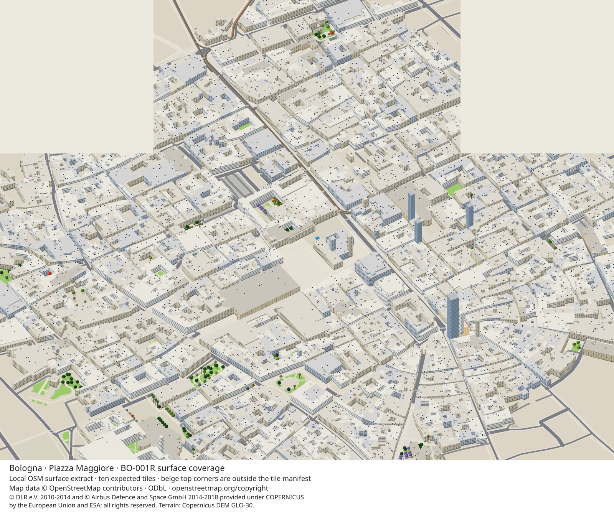
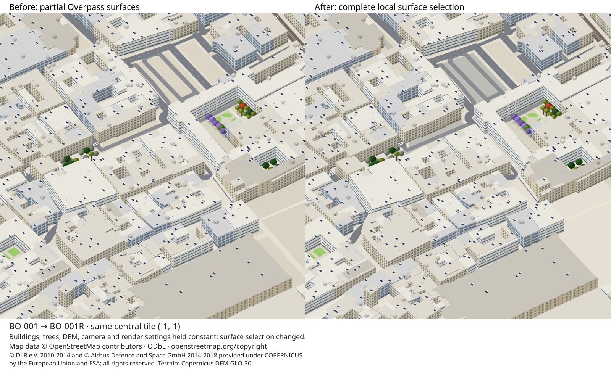

# BO-001R — Bologna OSM surface coverage and render validation

Completed 2026-11-19. [Updated proof](bologna-proof-coverage.jpg) ·
[before/after comparison](bologna-coverage-comparison.jpg) ·
[source validation](bologna-coverage-source.json) · [render QA](bologna-coverage-qa.json).

## Result and scope

The required OSM surface selections are now acquired from a **dated local Geofabrik PBF**,
with no Overpass dependency. The new ground input contains **16,158** elements, retaining
all **14,729** BO-001 elements and adding **1,429**. Ground features increased from
14,151 to **15,377**. All required categories are present and parsed. The optional golf
selection is successfully acquired but empty; optional animation rail routes remain unassembled.

Both manifests expect the same **10 tiles**, in a 4×3 composition grid. Coordinates
**(-2,-2)** and **(1,-2)** are absent from both manifests: the two beige top-corner cells
are intentional composition background, not missing or failed rendered tiles. All ten expected
color tiles and all ten height tiles exist, decode, have correct dimensions, contain variation,
and have **minimum alpha 255**. The new proof keeps the intentional corners beige.

No BO-001 source, derived file or proof was replaced. All **82** files recorded in
[the preservation inventory](bologna-coverage-preservation.json) still match their SHA-256 and
byte sizes, including the original proof, raw partial cache, municipal audit downloads,
derived ground/scene/render/height/manifest and frozen region/camera code. New outputs live in
`data/bo-001r/`; original outputs remain in `data/raw/` and `data/derived/`.

## Acquisition, provenance and clipping

- Source URL: `https://download.geofabrik.de/europe/italy/nord-est-261117.osm.pbf`
- Local download completed: **2026-11-19T09:18:48.877Z** (download file mtime; curl did not preserve server mtime).
- Publisher dataset timestamp: **2026-11-17T21:24:30Z**, replication sequence 4032 (PBF header).
- File size: **627,405,116 bytes**.
- Publisher MD5: `d5f5b980a0c0350eb34c2bb358230d85`, verified against the separately downloaded `.md5`.
- SHA-256: `3890fed2562138931ae60f155f977feb9fe4f4eca0413620a036b9dea0f85e2e`.
- Licence: **ODbL 1.0**, © OpenStreetMap contributors, as linked by the
  [Geofabrik source page](https://download.geofabrik.de/europe/italy/nord-est.html).
  Page, response headers, source PBF and checksum file are retained under `data/bo-001r/source/`.
  The HTTP Date header is cached upstream metadata and is recorded separately from the local download date.

Geofabrik distributes the existing OSM source, not an additional geographic dataset.
The existing OSM region credits/footer licence link remain applicable. ATTRIBUTION.md records
the distributor, licence and clipping/adaptation. Proof and comparison images visibly retain
OSM and full Copernicus notices. No municipal GIS geometry, proprietary imagery or AI painting is used.

The frozen area bbox is unchanged: [south,west,north,east] =
`[44.4893,11.337,44.4983,11.349]`. The surface clip adds **0.02° on every side**, exactly matching
the existing fetch/terrain margins: [west,south,east,north] = **[11.317,44.4693,11.369,44.5183]**.

Osmium 1.18.0 / libosmium 2.22.0 clips with `smart`, whole ways, and completion of relations
tagged with surface-related keys. Geometry is **not truncated** at the bbox. Complete relations
can therefore include members outside it. After decoding, objects with node/member vertices
inside the bbox are selected, matching the existing Overpass bbox semantics rather than merely
testing centroids. As with Overpass bbox queries, a huge enclosing polygon with no vertices or
member-way vertices in the bbox is outside this selection contract; this is not a universal
geometric intersection query. The generous margin reduces boundary effects on the 1 km render.

The clipped PBF contains **332,542 nodes, 46,863 ways, 2,183 relations**.
`osmium check-refs` reports **zero missing way-node references**. Required selected surface
relation members must all resolve; missing ways/nodes or unsupported nested surface relations
cause failure. Every retained coordinate is finite and within geographic ranges. Tag decoding,
member roles and whole geometry are preserved in Overpass-compatible JSON; shared TLV/Stuttgart
fetch and parsing implementations are not changed.

The independent [acquisition script](bologna-osm-coverage.ts) applies the existing
`FILTERS.ground` semantics and validates each category against the decoded source selection.
Publisher MD5 mismatch, missing source files, invalid geometry, missing required categories,
category loss, altered cached clip/OPL hashes or a different pre-existing isolated ground file
fail explicitly. They are never converted into empty successful downloads. Repeated validation
uses cached files without overwriting original data.

| Selection (categories overlap) | BO-001 input | Local source = parsed |
|---|---:|---:|
| Highways, excluding specified tunnels | 12,032 | 12,032 |
| `area:highway` ways | 97 | 97 |
| Surface rail ways | 600 | 600 |
| Land use | 2,005 | 2,005 |
| Leisure/parks | 5 | 575 |
| Natural surfaces | 2 | 97 |
| Water / riverbanks | 0 | 23 |
| Selected amenities | 1 | 727 |
| Piers / breakwaters / groynes / bridges | 0 | 16 |
| Squares | 9 | 30 |
| Golf surfaces | 0 | **0, acquired-empty** |
| Runway / taxiway / apron / helipad ways | 0 | 2 |

Leisure and natural selections retain the exact existing value lists. Amenities retain parking,
school, university, college, hospital and graveyard semantics. Category counts can overlap because
one element can carry several relevant tags. The before input already had a few third-group tags
incidentally attached to highway/landuse elements; those did not constitute complete acquisition.
`bologna-coverage-source.json` includes node/way/relation counts per category and an explicit empty
reason for golf. Point amenities are retained as data even when the current ground renderer has
no polygon to draw; acquisition is distinguished from renderer support.

Rail animation routes are **optional and not emitted as `rails.json`**. The clip includes 48 rail-route
relations with geographically incomplete long-distance membership. Treating these as complete
animation data would be misleading. This does not omit surface railway ways: all 600 selected
surface rail ways are acquired. No train-animation or route-completeness claim is made.

## Reproduction and safe output isolation

Use the installed Node 24 through nvm. The initial system Node 18 render attempt was rejected by
Playwright; `nvm use 24` selected **v24.22.3**. No Node download/install was needed.

```bash
source "$HOME/.nvm/nvm.sh"
nvm use 24
mkdir -p data/bo-001r/source
curl -fL --retry 2 --max-time 600 -D data/bo-001r/source/download.headers \
  https://download.geofabrik.de/europe/italy/nord-est-261117.osm.pbf \
  -o data/bo-001r/source/nord-est-261117.osm.pbf
curl -fL https://download.geofabrik.de/europe/italy/nord-est-261117.osm.pbf.md5 \
  -o data/bo-001r/source/nord-est-261117.osm.pbf.md5
curl -fL https://download.geofabrik.de/europe/italy/nord-est.html \
  -o data/bo-001r/source/geofabrik.html
OSMIUM=osmium node --import tsx docs/bologna-osm-coverage.ts
```

The PBF URL is dated, avoiding `latest` drift. Retain the downloaded snapshot if Geofabrik
eventually retires that daily file. Reproduction requires the unchanged BO-001 `osm.json`,
`roads.json` and DEM from the audit; the acquisition script copies them with exclusive creation
and validates matching hashes. This holds buildings, trees, traffic roads and DEM constant.

Osmium was initially unavailable. Fedora packages were **downloaded and unpacked locally**,
with no system installation. The executed tool setup was:

```bash
dnf download --destdir=/tmp/bo-001r-tools osmium-tool
dnf --disable-repo='*' --enable-repo=fedora --enable-repo=updates \
  download --destdir=/tmp/bo-001r-tools boost-program-options
# In /tmp/bo-001r-tools, unpack the x86_64 RPMs with rpm2cpio | cpio -id --quiet.
export OSMIUM=/tmp/bo-001r-tools/usr/bin/osmium
export LD_LIBRARY_PATH=/tmp/bo-001r-tools/usr/lib64
node --import tsx docs/bologna-osm-coverage.ts
```

The script executes these substantive tool operations (full arguments/version in source JSON):

```bash
osmium fileinfo -e -j data/bo-001r/source/nord-est-261117.osm.pbf
osmium extract -b 11.317,44.4693,11.369,44.5183 --strategy smart \
  -S types=any \
  -S tags=landuse,leisure,natural,water,waterway,amenity,man_made,place,golf,area:highway,aeroway \
  -o data/bo-001r/source/piazza-maggiore-surface.osm.pbf \
  data/bo-001r/source/nord-est-261117.osm.pbf
osmium check-refs data/bo-001r/source/piazza-maggiore-surface.osm.pbf
osmium cat data/bo-001r/source/piazza-maggiore-surface.osm.pbf -f opl,add_metadata=false
```

`pipeline/src/paths.ts` now accepts an explicit `PIPELINE_DATA_ROOT`; without it every existing
default path is unchanged. BO-001R uses this isolated root, so `scene.ts` cannot clear the
original scene directory. The new scene directory was absent before its one build. No `--force`
or rerun deletion was needed. A new experiment should use a fresh root or make and verify backups;
do not rerun the scene command against either existing output directory blindly.

```bash
PIPELINE_DATA_ROOT=data/bo-001r node --import tsx pipeline/src/ground.ts piazza-maggiore
test ! -e data/bo-001r/derived/piazza-maggiore/scene && \
  PIPELINE_DATA_ROOT=data/bo-001r node --import tsx pipeline/src/scene.ts piazza-maggiore
PIPELINE_DATA_ROOT=data/bo-001r \
  CHROME_PATH="$HOME/.cache/ms-playwright/chromium-1234/chrome-linux64/chrome" \
  CHROME_ARGS=--use-angle=swiftshader \
  node --import tsx pipeline/src/render.ts piazza-maggiore -j 2
node --import tsx docs/bologna-coverage-qa.ts
node --import tsx --test docs/bologna-coverage-qa.test.ts
node_modules/.bin/tsc --noEmit -p pipeline
node_modules/.bin/tsc --noEmit -p web
git diff --check
```

The QA script reads the actual manifest, checks it against BO-001 and the frozen area math,
and writes only new `coverage` artifacts. It does not run the original proof script, which would
overwrite BO-001's proof. It recomputes all preservation hashes every time.

## Render comparison and checks





Both images were visually inspected. New park/pitch surfaces appear in courtyards and open
spaces, and water appears near the square; the footprint layout is unchanged. The central tile
has **5.35%** of pixels change by more than a summed RGB difference of 9, with mean per-channel
absolute change **0.886/255**. Across all tiles changes are modest (roughly 0–5.35% above that
threshold), because most added ground objects are outside the small patch, behind buildings or
overlap existing landuse surfaces. This is not a rendering of additional city area.

The montage has no missing expected cells or visible tile-sized gaps. Roads/blocks continue
across the 13 shared tile edges. A seam heuristic compares average RGB jumps across each edge
with adjacent interior pixel differences; no edge exceeded `max(12, 3×interior MAE)`.
This is a screening metric plus visual inspection, not a proof of subpixel seam perfection or
surveyed geographic accuracy. Two top corners intentionally remain outside the rendered set.

| Check | Outcome |
|---|---|
| Local PBF checksum, decode, way references and surface member geometry | PASS |
| Required categories and retained baseline surface IDs | PASS; no missing required category |
| Color PNGs | PASS: 10/10, 1024², nonblank, fully opaque |
| Height PNGs | PASS: 10/10, 256², nonblank, fully opaque |
| Manifest/camera/area consistency | PASS, identical ten coordinates and frozen camera |
| Preservation | PASS, 82 recorded files byte-for-byte unchanged |
| Terrain | PASS, 415×547 = 227,005 finite samples |
| QA regression tests | PASS, three cases: manifest corners/duplicates, invalid tiles, default/isolated paths |
| Pipeline TypeScript | PASS |
| New audit scripts TypeScript | PASS with strict no-emit check |
| Web TypeScript | Existing separate FAIL: untouched `web/src/scripts/map.ts:34`, TS2339 `ImportMeta.env` |
| `git diff --check` | PASS |

Ground has 4,044 junctions and 1,418 zebra crossings, unchanged. Buildings remain 3,028,
tree crowns 218 and scene bins 21. Some derived terrain values change because newly acquired
water polygons activate the existing water-flattening step; the copied DEM itself is identical.
Examples of drawable feature increases: park 1,708→2,076; campus 1→90; wood 7→24;
water 0→23; parking 0→492; playground 0→34; pitch 0→91; pool 0→31.
Complete per-kind counts and per-tile hashes are in the render QA JSON.

SHA-256 handoff anchors:

| Artifact | SHA-256 |
|---|---|
| Clipped PBF | `fe9c9a437a75b89fe5a6ec06ca872df71576cf07194a561275710301775b7502` |
| Complete surface JSON | `a8910b42b33be5c625eb071e7f7aa486cbb4750c1c214e9d32e39ee938c8522b` |
| Updated proof | `4a4da235c57909ea3efdb20396e6da986db3ac8f85e1bb1d8d7094ef91608f9f` |
| Comparison | `0615957ee5cd1510656d901d5a782008ae35dbcd3055d58d49a69c405f352a84` |

## Changes, handoff and remaining limits

Tracked modifications: `pipeline/src/paths.ts` (opt-in root only), `ATTRIBUTION.md` (OSM distributor provenance).
New files for review/staging, including every helper and supporting JSON:

- `docs/bologna-osm-coverage.ts`, `docs/bologna-coverage-source.json`.
- `docs/bologna-coverage-qa.ts`, `docs/bologna-coverage-qa.test.ts`, `docs/bologna-coverage-qa.json`.
- `docs/bologna-coverage-preservation.json`.
- `docs/bologna-proof-coverage.jpg`, `docs/bologna-coverage-comparison.jpg`, this report.

Raw PBF/clip/OPL, source pages, complete raw surface and new ground/scene/tiles/manifest are
gitignored under `data/bo-001r/`; preserve this directory for exact local reproduction.
No automatic commits were made. Bologna origin, heading, geoid and bbox are unchanged;
all TLV/Stuttgart source code and camera/source tables recorded in the preservation inventory
are unchanged. Default data paths are tested; no TLV/Stuttgart rerender was necessary or attempted.

“Complete” means all of the repository's specified ground source filters were successfully acquired
and parsed for this bbox/margin and snapshot. OSM can still omit real-world features. The renderer's
existing point-feature, courtyard, relation-ring, styling and estimated building-height limitations
remain; neither municipal geometry nor architectural improvements are included. Height-pass opacity
and variation do not independently certify absolute elevation accuracy. Optional animation routes,
website/traffic validation, export, publication and deployment remain outside this run.
