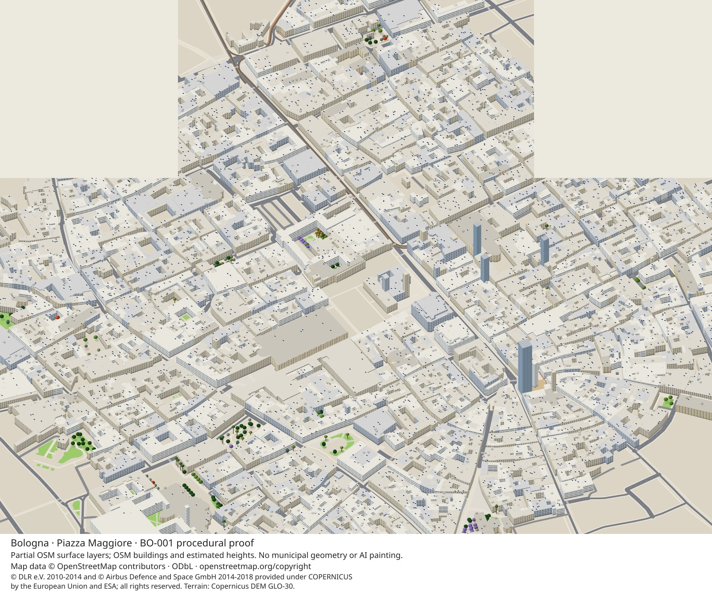

# BO-001 — Bologna geographic foundation

Audit date: 2026-11-16. Baseline: OSM buildings/trees/ground + Copernicus GLO-30,
procedural rendering only. Municipal data is downloaded and audited, **not consumed by scene.ts**.
No painting, export, publish, deploy or commit is part of this task.

## Primary sources and reproducible downloads

Run from the repository root (Node 24+, installed dependencies). Raw files are gitignored;
retain them as the snapshot. Live downloads can change. SHA-256, byte sizes, complete field
schemas, extents, catalogue dates and statistics are in [bologna-data-validation.json](bologna-data-validation.json).

```bash
mkdir -p data/raw/bologna-audit
curl -fL 'https://opendata.comune.bologna.it/api/explore/v2.1/catalog/datasets/c_a944ctc_edifici_pl' -o data/raw/bologna-audit/bologna-buildings-metadata.json
curl -fL 'https://opendata.comune.bologna.it/api/explore/v2.1/catalog/datasets/alberi-manutenzioni' -o data/raw/bologna-audit/bologna-trees-metadata.json
curl -fL 'https://opendata.comune.bologna.it/api/explore/v2.1/catalog/datasets/c_a944ctc_edifici_pl/exports/geojson' -o data/raw/bologna-audit/buildings.geojson
curl -fL 'https://opendata.comune.bologna.it/api/explore/v2.1/catalog/datasets/alberi-manutenzioni/exports/geojson' -o data/raw/bologna-audit/trees.geojson
curl -fL 'https://geographiclib.sourceforge.io/cgi-bin/GeoidEval?input=44.4938%2011.343&option=Submit' -o data/raw/bologna-audit/bologna-geoid.html
node docs/bologna-data-audit.ts
```

These are full exports, avoiding the records API's page/offset limits. Export counts exactly
match metadata: 65,735 buildings (47,821,655 bytes) and 87,285 trees (54,630,770 bytes).
No source authentication or proprietary imagery is involved. HTTP failure must not be cached
as an empty FeatureCollection. The validator checks count/licence agreement and records geometry
defects; it does not repair data or certify OGC topology.

Both catalogue metadata responses explicitly identify [CC BY 4.0](https://creativecommons.org/licenses/by/4.0/),
with no extra attribution text. Buildings publisher: Comune di Bologna – Sistema Informativo
Territoriale (SIT); trees publisher: Comune di Bologna – Settore Ambiente e Verde.
Credit publisher, link dataset and licence, retain notices and identify adaptation (projection,
extrusion, filtering and aggregation). Commercial reuse and derivatives are allowed. Attribution
is recorded in ATTRIBUTION.md; municipal map credits/footer are a prerequisite for a future adapter.

## Buildings: schema, heights and coverage

Source: [CTC – Edifici volumetrici](https://opendata.comune.bologna.it/explore/dataset/c_a944ctc_edifici_pl/).
Geometry is `geo_shape`, exported as GeoJSON `geometry` Polygon in WGS84 **longitude, latitude**;
`geo_point_2d` is a separate centroid object with named `lon`/`lat`, not the footprint.
`codice_ogg` is integer and unique/non-null in this snapshot. Attributes:

| Fields | Meaning/type |
|---|---|
| `quota_gron`, `quota_pied`, `altezza_gr` | double: eave elevation, foot elevation, relative eave height |
| `area_ogg`, `volume`, `perimetro` | area/volume double, perimeter integer; units not declared in field metadata |
| `descrizion`, `origine`, `noteogg` | textual classification, provenance, notes |
| `data_istit`, `data_varia` | institution/variation dates; not a guarantee of recent resurvey |

The municipal description states 1:2000 photogrammetric CTC production in 2001, eave/foot
elevations with **54 cm tolerance**, subsequently maintained using building applications, supporting
orthophotos/oblique surveys and more recently LiDAR. This is a publisher statement about capture,
not independent verification of every current record. No imagery mentioned there was downloaded
or used as reference. Metadata last data update: 2026-10-22.

| Validation | Whole export | Test patch (centroid within bbox) |
|---|---:|---:|
| Records | 65,735 | 3,385 |
| Zero eave height | 11,010 (16.75%) | 55 (1.62%) |
| Null / negative eave height | 0 / 0 | 0 / 0 |
| Height median / p95 / maximum, m inferred | 7.8 / 24.1 / 103.7 | 14.6 / 26.9 / 94.5 |
| Missing or zero base/eave elevation | 11,102 | 58 |
| Positive base/eave with height discrepancy >0.1 | 0 | 0 |

Extent lon/lat: [11.230153, 44.421505, 11.431958, 44.555343]. The metadata territory includes
Bologna and Sasso Marconi; extent overlap is not proof of complete municipal coverage. Heights
are consistent with `quota_gron - quota_pied`, and metre scale is strongly supported by values
and the publisher's tolerance, but the export does **not declare a vertical CRS/datum**.
Do not treat these elevations as WGS84 ellipsoid heights, or assume EGM2008/Italian national
levelling without further municipal documentation. Relative `altezza_gr` can be used independently
of absolute datum after rejecting zeros. It measures eaves, not ridge height or roof geometry.

All geometries have expected type and finite geographic coordinates; all rings are closed and
have at least four coordinates. There are **2,752 interior rings**. Self-intersections, overlapping
volumes, hole containment and coverage against an authoritative boundary still need GIS topology
QA. The existing OSM fallback takes only one outer ring of relations: do not reuse that simplification
for municipal courtyards. Categories include canopies, porticoes, churches, ruins and elevated links;
not every polygon is a solid building to extrude from ground level.

## Trees: schema and limitations

Source: [Alberi in manutenzione](https://opendata.comune.bologna.it/explore/dataset/alberi-manutenzioni/).
`geo_shape` exports as Point [lon,lat], with a separate `geo_point_2d` object. `num_pt` (text) is
unique/non-null here; `cod_alb` is another code and must not be assumed globally unique.
`classe` is the species string; `cl_h` is a **class**, not numeric measured height.
Other fields include `dimora`, `isolato`, `irriga`, `pregio`, `classe_circonferenza_diametro`,
`data_inv`, `data_agg`, `data_impnt`, `d_edif`, `campagna`, `in_patrim`, `anni_impnt`,
`zona_di_prossimita`, `area_statistica`, `quartiere` (full schema in JSON).

| Height class | Records |
|---|---:|
| <6 m | 34,198 |
| 6–12 m | 24,837 |
| 12–16 m | 12,942 |
| 16–23 m | 11,803 |
| >23 m | 3,481 |
| Null / literal `NULL` / malformed class | 20 / 3 / 1 |

No missing/invalid point geometries; extent [11.232219, 44.421352, 11.433451, 44.551994].
1,565 records lack species; 72,850 lack planting dates; 6,894 lack update dates. 46,661
have update years 2005–2007: catalogue freshness (2026-10-10) is not tree observation freshness.
The test bbox contains 166 points, two without species and 140 without planting date. Dominant
citywide species are Celtis australis, Acer campestre, Platanus acerifolia, Fraxinus excelsior
and Tilia intermedia; the patch has many Gingko biloba (source spelling) and Magnolia grandiflora.
This is a maintenance inventory, not complete canopy coverage or a survey of every private tree.
No crown radius or numeric vertical datum is supplied. Preserve species strings and provenance;
future class midpoint/open-ended assumptions must be labelled estimates. No tree style sheet is
created for this procedural baseline.

## Fixed camera, ENU and terrain references

Region `bologna`; area `piazza-maggiore`; bbox [south,west,north,east] =
**[44.4893, 11.337, 44.4983, 11.349]**, approximately 1 km north/south by 0.95 km east/west.
Origin **44.4938° N, 11.343° E, h=0 m WGS84 ellipsoid**, at Piazza Maggiore.
Heading **315°**, pitch 45°, resolution 0.25 m/art-pixel, tiles 1024 px. Heading NW gives both
facades for approximately north/south and east/west central streets. This is a deliberate baseline
choice, not a fitted cadastral grid bearing. No airport or broader regional outline is added.
These origin/heading values were set before creating render tiles and must now remain fixed.

The existing camera converts WGS84 geodetic coordinates to ECEF and then local ENU; `h=0` is
the tangent origin on the ellipsoid, **not local ground or sea level**. GeographicLib's EGM2008
evaluation at the origin returns **N=39.6470 m** (saved HTML; EGM96 gives 40.3994 m and must
not be substituted). `geoidM=39.647`; `groundH=100` is only an initial ellipsoid-height estimate
(roughly 60 m MSL + N), used for area tile selection. Actual buildings follow filtered terrain.
No heightBase offset is needed for this central patch; use the default encoded range −100…555 m.

[Copernicus official product description](https://dataspace.copernicus.eu/explore-data/data-collections/copernicus-contributing-missions/collections-description/COP-DEM)
specifies horizontal WGS84-G1150 and vertical EGM2008 (EPSG:3855). GLO-30 is a **surface model**,
not bare earth: buildings and vegetation remain. `ground.ts` uses a morphological opening and
blur, samples a 10 m ENU grid and adds N once, with tangent-plane curvature correction. A 10 m
output grid does not increase the ~30 m source resolution. A constant geoid offset is adequate for
this test, not surveyed vertical accuracy over a whole region. Dense blocks and porticoes can
retain terrain bias. No camera.ts or shared terrain-math change is needed.

```bash
curl -fL 'https://copernicus-dem-30m.s3.amazonaws.com/Copernicus_DSM_COG_10_N44_00_E011_00_DEM/Copernicus_DSM_COG_10_N44_00_E011_00_DEM.tif' -o /tmp/bologna-dem.tif
mkdir -p data/raw/dem
cp -n /tmp/bologna-dem.tif data/raw/dem/Copernicus_DSM_COG_10_N44_00_E011_00_DEM.tif
```

Copernicus credit must stay intact as recorded in ATTRIBUTION.md:
“© DLR e.V. 2010-2014 and © Airbus Defence and Space GmbH 2014-2018 provided under
COPERNICUS by the European Union and ESA; all rights reserved”. Public GLO-30 is free under
its specific licence (not CC BY); the existing pipeline uses the anonymous AWS open-data mirror.

## OSM baseline and municipal adapter plan

[OpenStreetMap copyright/ODbL](https://www.openstreetmap.org/copyright) permits this use with
visible “© OpenStreetMap contributors”, licence link, and derived database obligations; pipeline
remains public as the method to recreate it. Existing footer already links OSM and Copernicus;
no new municipal footer link is appropriate while the rendered map contains no municipal data.
Baseline region credits contain only active OSM/Copernicus sources, without an AI-painting label.
The OSM country filter is `name:en=Italy`, municipality `name=Bologna`, `admin_level=8`;
live boundary verification results are recorded below. No border overlay has been exported.

The existing `sources`-unset path already fetches only OSM and Copernicus. It does not read TLV
municipal files; LGL handling remains behind `sources === "lgl"`. BO-001 changes no fetch/scene
logic. Render manifest attribution now distinguishes this OSM-only path from TLV rather than
incorrectly labelling every non-LGL region as Tel Aviv municipal data.

Future adapter (separate task):

1. Add an explicit Bologna source switch; keep `sources` unset as the reproducible baseline.
   Cache municipal snapshots and metadata separately, with count/licence/hash validation;
   select footprints by spatial intersection, not only centroid, with render-edge margin.
2. Normalize Polygon/MultiPolygon rings in lon/lat to ENU preserving holes, separate volumes,
   IDs, dates and provenance. Verify topology, overlaps and courtyard geometry before extrusion.
3. Prefer positive municipal relative eave heights; reject sentinel zero/nonfinite/implausible
   values and fall back to OSM height → levels → documented heuristic. Resolve absolute vertical
   datum with the SIT before using `quota_pied` or `quota_gron` to position buildings. Do not add
   the geoid to a relative height. Avoid painting porticoes/elevated links as full solid blocks.
4. Trees: parse height classes with explicit estimated heights/radii, preserve species and age
   uncertainty, deduplicate OSM point trees spatially; retain OSM parks/woodland fallback.
5. Add municipal CC BY publisher/licence links in region credits, render manifest, footer and
   any clips before producing municipal map artifacts. Keep TLV and Stuttgart source branches
   and frozen camera tables unchanged; compare baseline landmarks and coverage before rollout.

## Execution and QA

Commands and final results are recorded below after pipeline execution. No generated data is
removed. The standard scene command clears its scene directory on reruns; BO-001 invokes it
only for a new area with no existing scene bins.

### Commands executed and outcomes

The curl metadata/export/licence/DEM/geoid downloads above succeeded after sandbox DNS restrictions
required network escalation. Source copyright/licence pages were also saved locally (OSM copyright,
Copernicus AWS registry and official product description, CC BY deed, GeographicLib geoid documentation).
No package installation was needed. Standard `tsx` also required escalation for its local IPC socket.

```bash
node docs/bologna-data-audit.ts
node_modules/.bin/tsc --noEmit -p pipeline
node_modules/.bin/tsc --noEmit -p web
npm run fetch -- piazza-maggiore
npm run ground -- piazza-maggiore
npm run scene -- piazza-maggiore
CHROME_PATH=/home/jacopo/.cache/ms-playwright/chromium-1234/chrome-linux64/chrome npm run render -- piazza-maggiore -j 2
# Recovery: independent OSM surface subset (explicitly incomplete)
node docs/bologna-fetch-surface.ts --partial
npm run ground -- piazza-maggiore
npm run scene -- piazza-maggiore
CHROME_PATH=/home/jacopo/.cache/ms-playwright/chromium-1234/chrome-linux64/chrome CHROME_ARGS=--use-angle=swiftshader npm run render -- piazza-maggiore -j 2 --force
node docs/bologna-render-qa.ts
git diff --check
```

The recovery helper was added after the first successful bounded subset download and was rerun
against that cache. It reproduces the selections/downloads without relying on temporary scripts.
For a clean complete surface download omit `--partial`. Existing `ground.json` is deliberately
preserved: validate the newly fetched responses, archive the partial file outside the active area,
then rebuild it and ground/scene/render. Do not simply rerun `fetch` and assume its existence-based
cache repairs the partial file. Its marker `data/raw/piazza-maggiore/BO-001-partial-surface.json`
must remain with this proof cache; the normal pipeline does not enforce this marker.

| Check | Result |
|---|---|
| Municipal snapshot validation | PASS: full counts/licences match; structural checks and quality statistics saved in JSON |
| Pipeline TypeScript | PASS |
| Web TypeScript | FAIL: untouched `web/src/scripts/map.ts:34`, TS2339 `ImportMeta.env`; environment typing issue not repaired in this data task |
| Whitespace/diff check | PASS |
| ENU round trip | PASS at origin and two bbox corners: latitude/longitude within 1e-8°, maximum height error 0.0000072 m |
| DEM decode | PASS: 3600×3600 float32 TIFF with overviews |
| Standard fetch | PARTIAL: OSM buildings/trees and roads succeeded; rail route request repeatedly failed; stopped only this task's fetch process after bounded recovery |
| Ground | Initial attempt blocked by missing `ground.json`; recovery PASS using documented partial surface |
| Scene | Initial attempt blocked by ground prerequisite; recovery PASS: 3,028 buildings, 218 crowns, 21 bins |
| Render | Initial prerequisite attempt blocked; default GPU attempt produced four transparent tiles; software WebGL rerender PASS: 10/10 nonblank 1024² color and 256² height PNGs |
| Website, traffic, border overlay | Not run; no export, local web changes or deployment |

Overpass failures encountered: main endpoint HTTP 502 (and 406 on bounded direct queries),
private.coffee 502/429, mail.ru 504. A separate municipality query **succeeded** on mail.ru:
relation **43172**, `name=Bologna`, `admin_level=8`, `ref:ISTAT=037006`, `ref:catasto=A944`.
Country-name verification timed out, so `name:en=Italy` remains an unverified configuration value
in this run. Full administrative overlays and optional rail-route data remain outstanding.

Buildings/tree OSM snapshot timestamp: 2026-11-16T07:45:08Z. Of 3,072 tagged building elements,
55 have positive explicit height, 48 have levels, and 2,984 have neither (these groups overlap).
The scene accepts 3,028 after geometry/type filtering. The fallback is levels ×3.2 +1 m,
then footprint/type heuristics (5/13/14 m), so most apparent heights are estimates.

Recovered surface: 12,727 road/area-highway/surface-rail elements plus 2,005 landuse elements,
deduplicated to **14,729**. Remaining `fetch.ts` third-group selections (parks, natural surfaces,
water, amenities, squares, aeroways, etc.) failed even with a split-query retry and are **absent**.
These are missing data, not a claim that Bologna has no such features. Actual raw subset responses,
OSM source timestamps, and their provenance are retained in `data/raw/bologna-audit/`.

Ground output: 14,151 drawable features, 4,044 junctions, 1,418 zebra crossings;
415×547 samples at 10 m (227,005 finite samples), ENU up 74.0249…293.9883 m across the patch
**plus its large terrain margin** reaching the southern hills. No tile/paint/published data was deleted.

### Rendered proof and visual review



[QA results](bologna-render-qa.json) and [reproducible QA/proof script](bologna-render-qa.ts).
Full-resolution color/height tiles, scene bins and manifest are in
`data/derived/piazza-maggiore/` (gitignored, preserved). The proof sheet carries visible OSM and
full Copernicus credits; unrendered bbox corners have a neutral background.

Visually inspected the central tile and final sheet. Building blocks and streets render, but this
is generic procedural massing: flat roofs, generic facade grids and house-style tree colors,
not a Bologna architectural reconstruction. Roof details are procedural decoration, not survey data.
Courtyards/compound relations can be filled or simplified by the existing OSM fallback. Portico
clearance, church roofs, landmark/tower silhouette accuracy, seam tolerances and alignment to a
surveyed control network are not validated. The default GPU backend gave transparent PNGs without
throwing; explicit SwiftShader solved this here. The proof validator detects blank color tiles;
it does not certify height-pass vertical accuracy or independently measured geometry.

BO-001 establishes a standalone frozen geographic baseline and a reproducible **partial-surface
render proof**. It does not establish complete surface coverage, surveyed absolute municipal
elevations, municipal adapters, or a publishable city. Next work: repair OSM coverage/cache,
resolve the municipal vertical datum and topology, then implement the scoped adapters above.
