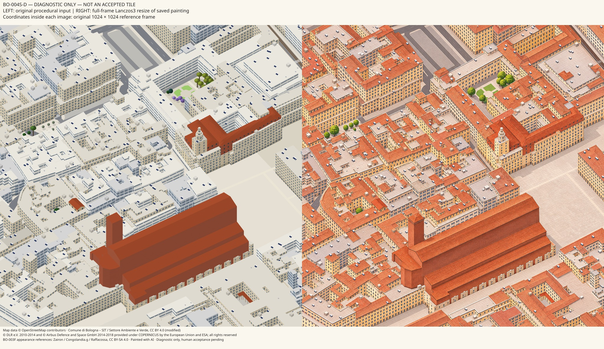

# BO-004S-D — offline painting assessment

## 1. Executive decision

**REFINE_REQUIRED — humanAcceptance: PENDING / HUMAN_ACCEPTANCE_REQUIRED.** All offline gates are complete. The original live run remains **FAILED_NO_RETRY**, with `qaFailure: WRONG_OUTPUT_DIMENSIONS`; no historical status was repaired.

| Dimension | Assessment |
| --- | --- |
| File format | FORMAT_RECOVERABLE: an opaque diagnostic 1024² PNG can be produced deterministically |
| Alignment / framing | UNCERTAIN: full-frame scale best explains coarse alignment; exact geographic correspondence is unproved |
| Topology / architectural fidelity | FAIL: source-flat roofs acquired pitched planes and extra roof volume |
| Style | Strong warm Bologna palette; medium match to the house style; historical details unverified |
| Human acceptance | PENDING; this assessment cannot approve a map tile |
| Seams, scalability, prior cost | NOT_TESTED; no cost or internal-call count inferred |

The candidate is retained as a valuable appearance experiment. Known roof changes block use as a geographic tile even though the old edge heuristic passes. No candidate registration, production export, painting or deployment followed this report.



## 2. Source evidence and isolation — Gate 0

Initial state: branch `feature/bo-004s-d-offline.qa`, HEAD `7d5576c`; only `plans/BO-004S-D-offline-painting-qa-recovery.md` was untracked. Created **feature/bo-004s-d-offline-qa** from that HEAD after inspection. Nothing was staged/reset/committed. The initial shell selected Node v18.20.4; explicitly ran `nvm use 24`, selecting **v24.22.3** for all implementation/check commands.

Authoritative candidate: `data/bo-004s-codex-recovery-r1/execution/raw.png`. Corresponding source assets and prompts are the **exact staged recovery work files**, not recomposed images from another experiment. The recovery approval pins these files; its SHA is `78093fd8031876d2d039c7e5caace97e5dba29e8ee3acd870976ec204d3735ac`.

| File | Bytes | Dimensions | SHA-256 |
| --- | ---: | --- | --- |
| `execution/raw.png` | 4,393,198 | 1254×1254 | `4edf05309116fea5e631be83bc444f3795483f53028e3fef3e3353b6975c9458` |
| `execution/work/input.png` | 1,103,640 | 1024×1024 | `4fe7341333fb3be87eb2750617d62de9ebbb95fc662a367b14619259492da2b0` |
| `execution/work/height.png` | 388,406 | 1024×1024 | `4f82a0825746efd275e623c8e066c1e0c85236e726a902ec27118ec7800ce6a2` |
| `execution/work/prompt.txt` | 3,713 | text | `0674b6b7424c30e80d229b783251dea2121bc69c3014cd49de495fbfcc62266e` |
| `execution/work/invocation-prompt.txt` | 3,703 | text | `4e6d294af147cb41c4a36cf9c3845e35575c0cd6812695f8b66a2547b1e422ae` |
| `data/bo-004s-d-offline/diagnostics/resized-full-1024.png` | 3,000,284 | 1024×1024 | `161b0f558d15a0a313b39c44ccd41b4c00cc993f4fa357b1ed001f435402ae8e` |

All `execution/` paths in the table are relative to `data/bo-004s-codex-recovery-r1/`. [Inventory](bologna-paint-offline-inventory.json) provides absolute/relative paths, all four input/reference pins, prompt pins, metadata and protected evidence pins.

Raw and derivative: RGB, 8-bit, sRGB, opaque, no ICC profile or orientation, no black pixels or dark 8×8 cells. Procedural input and height: RGBA, 8-bit sRGB, all alpha 255, no ICC. Height contains legitimate black low-height areas; the generic color-output `validOpaquePng` suitability predicate is false for that guide because of its dark cells, **not because the height PNG is corrupt or transparent**. The guide was decoded and visually inspected. The style sheet retains 2048×1024; the tree sheet is 1024×1024. Neither was changed.

Preservation verification:

- 1,410 baseline protected pins, 41 original recovery evidence pins, 110 native prior pins and all 7 staged work pins match.
- Original native, API and recovery handoff inventories match **38 / 32 / 94** files respectively. Counts overlap; they are not summed as distinct files.
- A new **1,645-file** current-state inventory additionally protects the completed execution, raw, `work/out.png`, journal, original QA/result, stdout/stderr and earlier paint docs. It matches after diagnostics, checks and final assessment.
- Root `data/bo-004s-d-offline/` was exclusively created and is gitignored. No existing output root or document was replaced. Only new diagnostic outputs and new `docs/bologna-paint-offline-*` files were written.

No provenance mismatch, source snapshot ambiguity or Gate 0 blocker was found. No private transcript, authentication store or secret value was copied into public QA outputs. Log evidence is reduced to sanitized event types and dimension-presence booleans.

## 3. Why 1254×1254 — Gate A evidence

**Generator size-choice cause: UNKNOWN.** The saved log contains a completed shell copy of a PNG under `.codex/generated_images/...` to `out.png`; its `file` output reports **1254×1254 RGB**. The final agent message states the tool returned that size and the raw output was preserved without resize or retry. The log-referenced generated file still exists locally and was independently hashed: it has the same 4,393,198 bytes and SHA as the saved raw. This supports a byte-preserving save rather than wrapper re-encoding.

The prompt explicitly requests exactly 1024×1024, pixel-aligned source geometry and no padding/rescaling. The saved event stream does not expose a tool parameter/response that explains the dimension choice. A generation-service default, upload behavior or resizing bug cannot be established from these records. The copy command was inspected as text, never executed by this task.

The completed attempt journal records start **2026-11-20T15:59:52.265Z** and finish `FAILED_NO_RETRY`; result records finish **16:02:11.870Z**, one outer process, exit 0, no signal/stop reason, no registration. These statements do not establish internal image-tool count, allowance change or a dollar cost. Those remain as recorded: `UNKNOWN_NOT_HARD_CAPPED`, `NOT_OBSERVED`, `UNKNOWN_NOT_INFERRED`.

## 4. Transform comparison and measurements — Gate A

Only one image conversion was made: **entire raw square → 1024², Lanczos3, scale 1024/1254 = 0.8165869218500797, translation (0,0)**. It preserves the file's complete extent, not necessarily its geographic content. No local warp, rotation, inpainting, recoloring or content repair was applied. Composites and crops are diagnostic presentation only.

| Hypothesis / measurement | Result and limitation |
| --- | --- |
| Full-frame resize | Best-supported coarse framing hypothesis; diagnostic only |
| Extra constant padding | Not supported: outer 3% band grayscale standard deviations top/bottom/left/right are 42.49 / 40.16 / 40.59 / 42.41 |
| Center crop | Not produced: no objective same-geographic-extent crop boundary; cropping would remove perimeter artwork |
| Additional global edge fit | Best scale 1.00, translation (0,0), exploratory score 0.45664; search ±6% scale in 1% steps, ±24 input px translations in 8 px steps |
| Original QA edge correlation | **0.491726**, above heuristic 0.45; exact same Sobel/blur/sampled interior metric, not topology proof |
| Border correlation top/bottom/left/right | 0.54513 / 0.42121 / 0.37584 / 0.55270; scene reaches all borders, small missing/shifted perimeter content still unverified |
| Local edge-patch proposals | 25 patches distributed over five rows/columns; 5 pass exploratory NCC ≥0.65 and peak margin ≥0.06; none are authoritative controls |
| Single scale/translation fit to those 5 proposals | Scale 0.983382, dx 6.9084, dy 4.6703; residual median **8.663 px**, p95 **14.044 px**, worst **21.404 px** |

Residuals use original input-pixel units. The helper uses a lower empirical quantile (`floor((n−1)q)`); with only five unverified points p95 is especially weak. Per-proposal residuals, quadrant, NCC, peak margin and coordinates are retained in `alignment-hypotheses.json`. The points span all quadrants but are **texture patches, not verified landmark correspondences**. In particular the smooth piazza patch at (880,704) produces a suspicious displaced match; the residuals cannot be interpreted as surveyed displacement or proof of nonuniform distortion. This set cannot certify a global transform. No attempt was made to warp away its inconsistent residuals.

Road/corner/tower/roof comparisons are available for review in nine named crops and the whole-window overlay. The [50% overlay](bologna-paint-offline-overlay.png) has a fixed 1024² coordinate image at the top and a caption/credit band below; the uncaptioned exact 1024² overlay and a cyan patch-center review overlay are also retained under diagnostics. The height image is an interpolated sqrt-height guide, not footprint, roof-plane, tree or underpass segmentation. No geometry masks were inferred from painted textures.

**Conclusion:** same-framing uniform scale is plausible at coarse scale; exact spatial recoverability is **UNCERTAIN**. Texture differences, weak controls and known roof changes prevent a geography PASS.

## 5. Geographic and architectural QA — Gate B

All crop boxes are **[x,y,width,height] in the original 1024² frame**. Candidate crops use only the unaccepted full-frame hypothesis. Thus strong visible changes can be diagnosed, but pixel-level matches remain uncertain. [Paired crop sheet](bologna-paint-offline-crops.jpg), individual lossless crops and `diagnostics/crop-manifest.json` preserve the evidence.

| Check | Status / severity | Evidence / finding |
| --- | --- | --- |
| Road axes/edges | UNCERTAIN / major | `north-road` [260,0,270,215], `west-trees` [20,300,190,145]: long road/island recognizable; exact widths, corners and entrances unproved |
| Building volume topology | FAIL / major | `NW-flat-roofs` [0,0,310,300], `SW-blocks` [5,570,290,320]: additional roof volume changes silhouette; horizontal footprint merging is not established |
| Roof planes | **FAIL / blocking** | NW, SW and `central-voids` [190,260,350,260]: flat source roof faces acquire sloping terracotta planes, ridges and roof projections |
| Courtyard voids | UNCERTAIN / major | Central, NE and SE crops: large voids visible; new roof edges and occlusion prevent complete void/connectivity validation |
| San Petronio | UNCERTAIN / major | [295,550,560,415]: recognizable nave, stepped roofs and existing tower; exact segmentation/eaves/silhouette not independently certified |
| Palazzo d'Accursio | FAIL / major | [610,270,225,230] and NE: surrounding flat portions acquire pitched/ridged roof transitions; broadly retained tower does not prove architecture fidelity |
| Pilot portico | UNCERTAIN / blocking | `SE-portico` [790,870,234,154]; existing selection's 21018 locator at (874.577,970.052), not a newly inferred CTC identity. Open void remains visible; supports and clearance not certifiable |
| Trees | UNCERTAIN / major | NE [470,90,330,220] and west: crown size/texture/grouping changes; one-to-one counts/positions and roof occlusion unresolved; no visible palms |
| Framing | UNCERTAIN / blocking | Whole window and all borders: coarse framing good, precise perimeter/camera consistency unproved |
| Visual language | PASS / minor, appearance only | Warm palette, stone paving, rounded crowns; no coastline imported. No new historical-material, clock-face or species fact established |
| Diagnostic file format | PASS / minor | Valid opaque 1024² derivative; no dark-band cells; does not change original live QA |

San Petronio's source roof planes are themselves labelled procedural BO-003F estimates. The illustration cannot validate them historically. No claim is made that a new church tower or clock face was invented where the evidence does not show that. Windows, hatch texture and facade details are aesthetic output, not surveyed features.

**Structural gate: FAIL** because of known roof changes, regardless of edge score. “Blocking” means unusable as a faithful map tile; the intact artwork remains useful for refinement, hence `REFINE_REQUIRED` rather than destruction or automatic rejection of the experiment.

## 6. Recommended path — Gate C

Keep the immutable raw and derivative as a **refinement reference**, not a seam-test-ready tile. The smallest next step is human review of the NW/SW roof crops and the portico crop. Resolve geometry expectations before authorizing any second window. Human acceptance is explicitly pending and does not unlock registration here.

Potential later work, **not performed or authorized by this offline assessment**:

1. Improve source procedural roof/facade/street materials so a style transfer needs less inferred architectural change, while retaining verified geometry.
2. Refine the prompt/reference demonstration to distinguish flat terracotta-colored surfaces from new pitched roof volumes. The current prompt already prohibits topology changes; stronger wording alone is no guarantee.
3. Establish operator-reviewed road/footprint control pairs and a roof/portico acceptance checklist before any new painting experiment. Investigate output-size control separately with evidence, not by treating this resize as a fix.

A later second-window seam experiment needs separate authorization, accepted spatial/structural evidence and the human gate. Seams, scalability, cost and production suitability are all **NOT_TESTED** by this one candidate.

## 7. Engineering and reproduction — Gate D

**139/139 selected tests passed**, including **15** new offline tests. Six check groups passed: pipeline TypeScript, web TypeScript, strict QA-script TypeScript, offline/regression tests, permission-restricted read-only verification and `git diff --check`. The previous `ImportMeta.env` issue does not reproduce. Exact commands, exit codes and log SHA-256 values are in [checks JSON](bologna-paint-offline-checks.json), also embedded in [QA JSON](bologna-paint-offline-qa.json).

Two pre-existing positive tests asserting that the original/recovery execution roots are unused were explicitly excluded: both roots have now been consumed. Test sources and one-shot guards were not changed. Negative reuse tests remain selected. No previously failed historical run was reclassified. Initial fixture development exposed a rounded-sampling scale tie and test type-narrowing errors; these were corrected before the final checks. The first sandboxed Node test subprocess failed at file level, so real tests ran outside that subprocess restriction; no provider was involved.

Tests cover source mismatch, immutable raw, deterministic 1254→1024 conversion, padding versus textured extent, global translation, local distortion, missing/degenerate controls, opacity/black bands/corrupt PNG, decision semantics, collision, forbidden production/traversal writes, crop bounds, no process/provider/live-wrapper dependency and historical status preservation. The exploratory scale search deterministically prefers scale 1 on exactly tied rounded matches.

Commands executed (from repository root; no live painter command):

```sh
git status --short
git branch --show-current
git log -3 --oneline
git switch -c feature/bo-004s-d-offline-qa
source /home/jacopo/.nvm/nvm.sh
nvm use 24
node --import tsx docs/bologna-paint-offline-qa.ts --run
node --import tsx --test docs/bologna-paint-offline-qa.test.ts
node --import tsx docs/bologna-paint-offline-check.ts
node --import tsx docs/bologna-paint-offline-qa.ts --finalize
node --permission --allow-fs-read=/home/jacopo/projects/isometricworld --allow-addons docs/bologna-paint-offline-qa.ts --verify
node --import tsx docs/bologna-paint-offline-qa.ts --freeze
node --permission --allow-fs-read=/home/jacopo/projects/isometricworld --allow-addons docs/bologna-paint-offline-qa.ts --verify
git diff --check
```

Additional read-only Python checks computed source/checksum metadata, parsed sanitized local log evidence and compared the saved generated-file hash; `view_image` inspected the raw, source, height, all nine crop pairs and control overlay. No downloaded image or remote source was consulted.

`--run` refuses an existing isolated root or output documents. To reproduce conversion/metrics independently, use the exported pure helpers on the pinned files; do not delete this root to rerun. `--finalize` consumes the explicit offline review and successful check results and exclusively creates the independent QA JSON. `--freeze` exclusively creates the new checksum inventory. `--verify` performs no writes and runs without child-process or filesystem-write permission. The diagnostic module graph has no network transport, process launcher or painter import. The check runner only runs the fixed local tools/tests above; no remote transport is exercised.

New untracked files: all `docs/bologna-paint-offline-*` artifacts listed below, plus the task plan that was already untracked. **No tracked files changed.** The ignored data root contains the full-frame resize, metadata, alignment/log evidence, measurements, control overlay, exact overlay, 27 per-crop PNGs, crop manifest and six engineering logs. All are included in the new checksum inventory. Original production renderer, native/API/live wrappers, approvals, tile manifests, map registration, published state and other regions are unchanged.

Total provider/image-generation requests for this task: **0**. No provider charge was initiated. Prior generation usage/cost remains unknown. Zero commits, zero publishing, no background job, no production AVIF export or registration, no deployment, no deleted dataset/evidence.

## 8. Artifact list for external review

The following list avoids copying the large source datasets:

```text
docs/bologna-paint-offline-report.md
docs/bologna-paint-offline-qa.json
docs/bologna-paint-offline-inventory.json
docs/bologna-paint-offline-comparison.jpg
docs/bologna-paint-offline-overlay.png
docs/bologna-paint-offline-crops.jpg
docs/bologna-paint-offline-checksums.json
docs/bologna-paint-offline-review.json
docs/bologna-paint-offline-checks.json
docs/bologna-paint-offline-qa.ts
docs/bologna-paint-offline-metrics.ts
docs/bologna-paint-offline-qa.test.ts
docs/bologna-paint-offline-check.ts
data/bo-004s-d-offline/diagnostics/resized-full-1024.png
data/bo-004s-d-offline/diagnostics/alignment-hypotheses.json
data/bo-004s-d-offline/diagnostics/raw-metadata.json
data/bo-004s-d-offline/diagnostics/crop-manifest.json
data/bo-004s-d-offline/diagnostics/control-review-overlay.png
```

All original data/style attribution remains applicable: © OpenStreetMap contributors; Comune di Bologna SIT/tree inventory CC BY 4.0 (modified); the exact Copernicus notice shown on the comparisons; existing project house-style/tree-sheet credits; BO-003F appearance references Zairon, Congolandia.g and Raffacossa, CC BY-SA 4.0. The paintings and diagnostic proofs are labelled **Painted with AI**, not approved geography. No new geographic/image source was introduced.

**STOP: offline report complete. Human acceptance remains pending; no further image generation, registration, export or deployment follows.**
