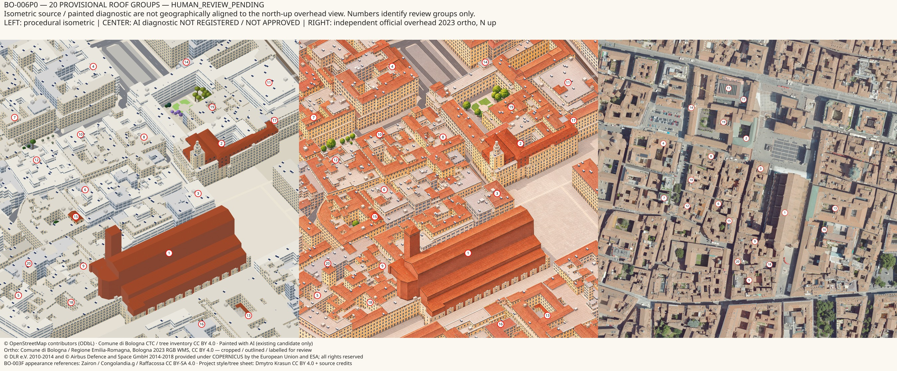

# BO-006P0 — roof truth and visual benchmark

## Decision and gate status

**Evidence sufficiency: PARTIAL · Roof truth: INFERRED_ONLY · Human acceptance: PENDING.** No roof is independently verified by this pilot. This is a bounded visual benchmark and proposed work plan, not a new map or permission to alter a roof.

| Gate | Result | Evidence / limitation |
| --- | --- | --- |
| 0: sources and provenance | PASS for primary ortho | Specific CC BY 4.0 WMS, live layer/CRS/format/coverage, existing source pins; optional DSM/LAS access and municipal tile-image rights remain unresolved |
| A: sample | PARTIAL | 20 distinct provisional roof groups / 33 original CTC IDs, required candidate strata present; 4/6 conflict candidates actually add pitch, 2 preserve flat caps; physical coherence is provisional, especially the narrow negative control |
| B: interpretation | PARTIAL | 15 inferred observations, 5 unknown, **0 verified**; no measured ridge height or material |
| C: review board | PASS | 20 full-size specimens, CSV/JSON, numbered three-view overview, full contact sheet plus five legible panels; separate north-up ortho, north arrows and approximate scale |
| D: decision and roadmap | PASS | Independent evidence/truth/human gates and separately scoped follow-ups below |
| E: engineering | PASS | 162 selected tests and all six check groups pass; 1,764 prior files unchanged |

Every specimen is **HUMAN_REVIEW_PENDING**. The existing painting remains **NOT_REGISTERED / NOT_APPROVED**. Historical live result is still `FAILED_NO_RETRY`; BO-004S-D remains `REFINE_REQUIRED`. No new render, painting, material change, registration, export, commit, upload, publishing or deployment occurred.

[Source/rights audit](bologna-roof-source-audit.md) · [Machine-readable QA](bologna-roof-qa.json) · [Full sample JSON](bologna-roof-sample.json) · [CSV](bologna-roof-sample.csv) · [Source registry](bologna-roof-source-registry.json)



## What this experiment establishes

A source-flat roof is not a measured real flat roof. The 2023 overhead reference supports some pitched forms that the procedural model omitted; it also contradicts at least one added illustrated pitch. These are provisional observations of **dated** evidence. They do not restore pixel alignment, prove metric ridges or establish unchanged roofs in 2026.

Representative cases:

- **Supported coarse pitched form — 03 / CTC 17870, Palazzo dei Notai:** overhead slope junctions support a hip; the procedural cap is flat and the painting shows a hip. This is evidence of procedural incompleteness, not accepted AI geometry.
- **Contradicted new pitch — 07 / CTC 59679:** overhead shows a grey terrace-like surface with perimeter treatment, while the painting adds a conspicuous gable. This is a strong contradiction against the **2023** reference; intervening alteration remains unknown.
- **Unresolved — 13 / CTC 53153:** a narrow, shadowed portico-adjacent volume cannot establish a coherent whole roof, type or clear height. No roof type or historic portico identity is invented. It remains a deliberately difficult negative control.
- **Control against unconditional improvement — 14 / CTC 19327:** the flat illustrated cap is contradicted by a small hipped-looking real roof. AI does not uniformly correct the procedural simplification.

San Petronio's nine source-linked parts form a compound church/tower review group, not one ridge. Its broad pitched system is supported, while estimated BO-003F shed rise and subpart functions remain unmeasured. Palazzo d'Accursio's CTC 47682/61154 form a separate complex; coarse pitched articulation is plausible but actual ridge transitions and the clock body's unresolved source join are not verified. IDs 31864/17875/45799/52776 are included only through actual source geometry and named OSM intersection, never by assuming their labels from this task.

## Sample design and grouping

The frozen scene and municipal snapshot yield 270 intersecting eligible CTC parts and 158 candidate roof-review groups. Parts with at least **80% of their own accepted polygon area** inside the same smallest valid OSM building envelope are grouped together; positive intersection of at least 1 m² is required. Boundary/bbox contact is insufficient. Original source IDs and any clipped `piece` IDs are retained. Unassigned CTC identities remain provisional roof envelopes. Sixteen incomplete/open/multipart relation candidates were skipped rather than guessed.

This groups coherent building/roof complexes where possible, rather than selecting 20 arbitrary volume rows. A CTC ID is a surveyed **volume part**, not a cadastral building or necessarily a whole physical roof. Multiple eave levels, clipped pieces, a tower or a lower band can occur within a single complex. Grouping is a review aid, not legal identity or a guarantee of one continuous roof. Original CTC geometries, accepted polygons, IDs, properties, eaves and ground anchors are unchanged. Named association is spatial, not independent historical verification; “Prefettura” is the OSM label, not an invented palace name.

Reproducibility: `BO-006P0/v4`, seed `BO-006P0/v1`, SHA-256 ordering plus farthest-point spatial distribution; named groups first, source-flat conflict-crop candidates, actual CTC holes, source-linked portico adjacency, flat-looking control, then ordinary envelopes including the one in-window ordinary gable estimate. Four landmark-sensitive groups, six conflict **selection candidates**, six ordinary groups, two courtyard groups and two negative/control groups are unique. The two nonconflict outcomes are retained and reported, not reclassified to improve counts.

Additive revisions are preserved in the isolated root: initial selection, v2, v3 and v4, each with draft evidence where generated. Manual exceptions are explicit in the sample JSON. Initial ordinary church/edge fragments were excluded; narrow strips 56185/47306 were rejected as poor ordinary roof units; the Santa Maria 49199 annex was replaced by the better-defined Prefettura 13030 envelope rather than calling a tiny annex the whole church roof. Final ordinary flat cases require an OSM envelope and adequate oriented width. The narrow portico control stays UNKNOWN intentionally. No geometry was merged or altered in the original data.

### Final twenty records

All coordinates, original properties, multi-part geometry, source methods/eaves, group rationale, pixel crops, confidence and rights are retained in JSON. All are HUMAN_REVIEW_PENDING.

| Specimen | CTC IDs | Stratum / name | Ortho observation | Confidence | AI coarse form |
| --- | --- | --- | --- | --- | --- |
| 01 | 17871 / 17875 / 18063 / 31864 / 32021 / 39022 / 45799 / 52776 / 59850 | landmark-sensitive / Basilica di San Petronio | complex | inferred | supported |
| 02 | 47682 / 61154 | landmark-sensitive / Palazzo d'Accursio | complex | inferred | supported |
| 03 | 17870 | landmark-sensitive / Palazzo dei Notai | hip | inferred | supported |
| 04 | 13030 | landmark-sensitive / Prefettura | multi_pitch | inferred | supported |
| 05 | 52919 | source-flat-AI-conflict-candidate | unknown | unknown | unresolved |
| 06 | 28290 | source-flat-AI-conflict-candidate | unknown | unknown | unresolved |
| 07 | 59679 | source-flat-AI-conflict-candidate | flat_or_terrace | inferred | contradicted |
| 08 | 54785 | source-flat-AI-conflict-candidate | multi_pitch | inferred | supported |
| 09 | 52921 | source-flat-AI-conflict-candidate | complex | inferred | unresolved |
| 10 | 26892 | source-flat-AI-conflict-candidate | multi_pitch | inferred | supported |
| 11 | 21285 / 26585 | courtyard / Sala Borsa | other | inferred | unresolved |
| 12 | 49142 | courtyard | multi_pitch | inferred | supported |
| 13 | 53153 | negative-control-portico-adjacent | unknown | unknown | unresolved |
| 14 | 19327 | negative-control-flat-looking | hip | inferred | contradicted |
| 15 | 61450 | ordinary | unknown | unknown | unresolved |
| 16 | 11105 / 38942 | ordinary | complex | inferred | unresolved |
| 17 | 12740 | ordinary | unknown | unknown | unresolved |
| 18 | 59868 | ordinary | multi_pitch | inferred | supported |
| 19 | 54719 / 61646 | ordinary | multi_pitch | inferred | supported |
| 20 | 18062 / 52920 | ordinary | complex | inferred | unresolved |

The separate `data/bo-006p0/grouping-audit.json` records ENU, WGS84 west/south/east/north and EPSG:3857 bboxes, area, centroids, screen bboxes, per-part eaves/categories/dates and actual OSM overlap fractions. All **20 complete source footprint envelopes fall within the acquired ortho**, not merely their centroids. Accepted plan area totals about **25,875.16 m²**; this is source polygon area, not measured roof surface area. Controls and partially visible isometric groups are not promoted to whole-building truth.

## Camera, coordinate chain and location uncertainty

The existing `pipeline/src/camera.ts` drives all ENU/ECEF/WGS84 and screen transforms. Frozen Bologna: origin **44.4938, 11.343, h=0**, heading **315°**, pitch **45°**, **0.25 m/art-pixel**, global window **[-896,128) × [-896,128)**; geoid **39.647 m**, unchanged. Screen x is right, y down. East shifts screen right/down; north shifts right/up. Pixels are not lat/lon.

`inputToPlane` intersects the ray defined by the existing `axes()` with a specified U plane. Per-roof centroid pixel locators use an area-weighted saved **eave** plane; that locator can lie over a courtyard or be occluded and is not a surveyed roof control. Per-part polygons use saved scene eave anchoring. Existing estimated roof uplifts can shift projected outlines by up to about 10 px; margins preserve context. No painting-derived geometry is used.

The precise **modeled-terrain** window boundary is separately solved against the existing bilinear ground grid, without extrapolation/clamping. [Projection JSON](bologna-roof-projection.json) records 32 perimeter samples, corners, iterations, source grid hashes and errors:

| Input pixel | Model-terrain latitude | Longitude | Ellipsoid height (m, modeled) |
| --- | ---: | ---: | ---: |
| (0,0) | 44.4936882141 | 11.3391733625 | 110.3485 |
| (1024,0) | 44.4953420013 | 11.3414145866 | 106.4559 |
| (1024,1024) | 44.4930158374 | 11.3446644695 | 109.9786 |
| (0,1024) | 44.4913685805 | 11.3424142095 | 112.8553 |

Terrain-ray maximum height residual **6.92e-8 m**, screen reprojection error **2.28e-13 px**. WGS84→ENU→WGS84→pixel round-trip maximum **1.71e-5 px / 6.06e-6 m** in the tested grid. These are floating-point consistency tolerances, **not physical accuracy**. The historical municipal ~54 cm statement concerns foot/eave survey elevations; no independent horizontal alignment accuracy is claimed. Real uncertainty includes datum/epoch differences, roof lean, ortho rectification, source partitioning, terrain approximation, occlusion and changes since 2023.

A separate low-percentile U=108.58 reference-plane quadrilateral and ground-to-U+70m ray envelope determined the bounded WMS context request; that reference-plane polygon is not substituted for the terrain footprint above. WMS is EPSG:3857 east/north XY; WMS1.3 EPSG:4326 would reverse geographic BBOX axes and is separately tested. North-up ortho remains visibly separate from the camera view.

## Source rights, epochs and acquisition

See the [source audit](bologna-roof-source-audit.md) and registry for exact URLs, UTC download times, capabilities, MIME/size checks and source SHA-256. The [official specific catalogue](https://geoportale.regione.emilia-romagna.it/servizi/servizi-ogc/elenco-capabilities-dei-servizi-wms/cartografia-di-base/copy_of_service-24) licenses the Bologna 2023 RGB WMS **CC BY 4.0**. Credit Comune di Bologna and Regione Emilia-Romagna; indicate reprojection/crops/CTC overlays/labels and retain licence/source links. Data acquisition is **2023-06-19–26**; local download is **2026-11-21**. The exact ortho tile day is unknown.

One 256² preview plus one bounded 2048² cluster supply all specimens. Full ortho: **9,237,589 bytes**, SHA-256 `3f025fc4c310f3019385d38b466901586201e162e53e3e272e8cf6b283fb0ac8`. Regional product is advertised as 20 cm resampling of 5 cm source photography; this requested context raster is approximately **0.257–0.258 ground m/pixel**, not a higher-resolution survey. BBOX **1262241,5541706,1262979,5542447**, advertised layer **Comune_BO_2023_RGB**, EPSG:3857, WMS1.3.0. Exact GetMap URL and affine sizes are in `wms-plan.json` and the request ledger.

**25 application attempts, 11 successes, 14 initial sandbox failures, 11,325,194 bytes**, sequential concurrency 1; four initial official web-tool URL opens are separately recorded. Even conservatively counting those actions remains below the 40-request action budget; application downloads remain well below 50 MiB. Failures are preserved, never filled with blank imagery. Initial metadata collector returned a failure summary with exit 0; the final utility explicitly returns nonzero for missing resources. The acquisition code now retries only transient HTTP errors at most once. No more acquisition was performed after the retained successful requests.

The 2023 LiDAR coverage GetFeatureInfo yields tile `32_686000_4929000`, date **2023-06-24**, metadata only; no DSM/LAS link or values were established. It is **NOT_ACCESSIBLE_FROM_INSPECTED_PUBLIC_RESOURCES**, not proven globally unavailable. The date is not assigned to the orthophoto. DTM is bare earth and cannot establish roof elevations. Municipal tile-directory catalogue metadata says ODbL; specific tile-image licence is unverified, so none was fetched. Regional 3D/other epochs were not substituted. All **ridge elevations, material measurements and roof pitches in degrees remain null/unknown**.

CTC full snapshot: 65,735 records, 47,821,655 bytes, SHA-256 `38ed98285663d6c3080c1b2f9929e99455d422590af92bd8c3c071bbbb3e465e`; dataset updated 2026-10-22. Source relative `altezza_gr` is retained, not a ridge. Absolute CTC height datum is unresolved and unused. Temporal changes between 2023 photography and 2026 CTC/OSM snapshots are possible; individual source dates can be much older.

Original procedural source SHA `4fe7341333fb3be87eb2750617d62de9ebbb95fc662a367b14619259492da2b0` (1024², 1,103,640 bytes); original AI raw SHA `4edf05309116fea5e631be83bc444f3795483f53028e3fef3e3353b6975c9458` (1254², 4,393,198 bytes); existing diagnostic SHA `161b0f558d15a0a313b39c44ccd41b4c00cc993f4fa357b1ed001f435402ae8e` (1024², 3,000,284 bytes). All match historical pins. No original is re-encoded or overwritten.

## Classification rules and quantitative baseline

Taxonomy: `flat_or_terrace` = no resolved pitched plane/terrace-like cap; `single_pitch` = one discernible sloping plane; `gable` = two main slopes meeting a ridge; `hip` = slopes on all sides; `multi_pitch` = multiple distinguishable pitched portions; `complex` = heterogeneous compound form; `other` = recognizable form outside the primitives, e.g. ribbed/glazed cover; `unknown` = insufficient form evidence. Color alone never establishes pitch or clay material. Brown/red surfaces are appearance inferences only. Openings and CTC holes do not automatically imply open air: Sala Borsa shows a central glazed/ribbed covering. No cadastral void is filled or changed here.

Confidence: **verified** needs clear evidence plus a second independent corroborating source or authoritative explicit geometry; **inferred** is a provisional single-ortho observation; **unknown** is unresolved. No entry reaches verified, including familiar landmarks. The previous roof photographs were not added as a second verification source. Painted roof labels describe illustrated outcomes only. “Supported” is coarse-form support, not registry/metric/topology acceptance.

| Baseline | Counts (all 20 retained) |
| --- | --- |
| Procedural | 17 flat caps; 2 complex estimated landmark systems; 1 estimated gable |
| Ortho observations | 6 multi_pitch; 5 complex; 2 hip; 1 flat_or_terrace; 1 other; 5 unknown |
| Confidence | 0 verified; 15 inferred; 5 unknown |
| Coarse illustrated-form evidence | 9 supported; 2 contradicted; 9 unresolved |
| Source-flat → illustrated nonflat subset | 11 cases: 7 supported; 1 contradicted; 3 unresolved |
| Dedicated conflict-candidate stratum | 6 candidates, only 4 visibly add pitch; 2 unchanged flat-looking caps retained as nonconflict controls |
| Source/ortho linkage | 20/20 complete source footprints inside cluster; 33 distinct CTC IDs; no repeated sample/group/CTC identities |
| Ridge/material/pitch measurements | None; null |

No accuracy percentage is reported. A single image plus provisional source groups is not a sufficiently independent labelled performance dataset. UNKNOWNs remain explicit, not excluded to improve a score. This suggests opportunities for source-linked roof primitives, not permission to modify them. Procedural incompleteness and painting topology divergence can both be true for a specimen.

## Review artifacts

- [Numbered overview](bologna-roof-benchmark-overview.jpg): separate procedural, painted and overhead frames.
- [All 20 specimens](bologna-roof-benchmark-details.jpg); legible panels [1](bologna-roof-benchmark-details-1.jpg), [2](bologna-roof-benchmark-details-2.jpg), [3](bologna-roof-benchmark-details-3.jpg), [4](bologna-roof-benchmark-details-4.jpg), [5](bologna-roof-benchmark-details-5.jpg).
- `data/bo-006p0/specimens-v4/BO006P0-XX/`: full-size unmodified input/paint/ortho crops, separate CTC-overlaid ortho, draft and reviewed boards, and per-specimen provenance/source links/rights/pins.
- `specimen-manifest-v4.json`: exact source-input crop rectangles, overhead affine crop coordinates, approximate ground scale and no-warp notice.
- `sample-selection-v4.json`, grouping audit, terrain projection, capabilities and original request ledgers; earlier draft selections/boards retained.
- [QA JSON](bologna-roof-qa.json), [source registry](bologna-roof-source-registry.json), [CSV](bologna-roof-sample.csv), [checksum inventory](bologna-roof-checksums.json).

The specimen's unmodified image pixels are preserved in individual PNG crops; contact sheets resize only for presentation. CTC outlines are overlays on separate overhead copies, not painted-derived geometry. North arrows and approximate local ground scale are explicit. Per-specimen JSON supplies source/licence links; the raster footer carries publisher/source/CC BY and existing map credits. Keep the registry/provenance with shared crops.

## Proposed follow-ups — not executed

| Package | Value / risk / effort | Acceptance metrics and prerequisites | Revert strategy |
| --- | --- | --- | --- |
| BO-006P1 materials | High / low–medium / small bounded pilot | Tile-safe warm plaster, masonry, paving and roof texture on **existing faces only**; geometry, eaves, holes, camera and height passes unchanged; all shared boundaries reviewed, no roof ridge fabricated; retain ambiguous/flat faces | Opt-in region/experiment flag, separate data root, original shader path and baseline pins remain available; discard only new experiment registration after human review, never delete original artifacts |
| BO-006P2 roof geometry | High / high / medium per reviewed group | **No automatic eligible group now**. Human-review exact source-linked specimen first; use independent roof-form evidence, explicit unmeasured-rise limits or licensed metric controls, preserve eaves/holes/CTC IDs and camera; no outside-footprint triangles, overlaps or courtyard fill; regress all baseline regions | Separate source-ID allowlist and versioned meshes/experimental root, default off; revert opt-in selection to old caps, retain all evidence |
| BO-006P3 landmark/portico | Selective / high / larger evidence-led study | Resolve clock-body join and support/clearance evidence first; no identity from nearby name or tiny nested top; no measured-height claim from DTM/ortho | Landmark-specific opt-in root and old meshes/pins retained; no global adapter change |
| BO-004S-E painting | Optional / high / one bounded authorized experiment only | Separate explicit approval; demonstrate or explicitly bound 1024² dimension, framing and roof/topology controls; reviewed source/roof masks/control pairs; no retries/bulk run under this approval | Isolated immutable raw and per-attempt journal, no tile registration until independent human acceptance; keep original procedural path |

P1 may safely experiment with deterministic surface appearance under the current geometry, after a separate task is authorized. P2 must not convert all 17 flat caps to slopes: some are real terraces, others unknown, and all ridge heights are unmeasured. Human review of specimens 03, 07 and 13 is the smallest useful next decision, not another citywide painting.

## Engineering, preservation and exact commands

Initial branch **feature/bo-006P0-roof-visual-benchmark**, HEAD **e5381e9a581e8a63bc9dedd221a5205dee2f291c**; only the new task plan was untracked. Node initially v18.20.4; explicitly selected **v24.22.3** with `nvm use 24`. No branch/reset/stage/commit action was needed.

**162 selected tests passed**, including **23 new roof tests**, plus pipeline, web and strict new-tool TypeScript, read-only verification and `git diff --check` (six groups). Web's older ImportMeta.env issue does not reproduce. [Final check manifest](bologna-roof-checks-final.json) records exact executable/argument arrays, exit codes (0), selected test count, log paths and output SHA-256. The earlier check manifest/logs remain: 161 tests passed there, but native strip-only mode could not parse an existing TypeScript parameter-property constructor; `--experimental-transform-types` resolved the verifier without changing production code. A new terrain-ray test brought the final count to 162. An initial transparent-image fixture was corrected to remove pre-existing alpha before adding 50% alpha; validation was not weakened.

Two old positive tests asserting unused painting roots remain excluded because both historical attempts are consumed; original tests and guards remain unchanged, and negative reuse tests are selected. No model/provider call occurs in these local fixture/mock tests. Network-capable acquisition is not imported into the benchmark/selection/projection test graph.

Before acquisition, 1,764 prior paths were pinned (including all 1,645 prior offline protected files and 53 handoff pins plus production sources); all still match. CTC/GIS snapshots, original painting/raw/derivative, historical journals/QA/logs/approval files, source exports, baselines, all regions and viewer/renderer remain unchanged. New outputs are exclusively created under the fresh ignored `data/bo-006p0/` and new `docs/bologna-roof-*`. No source imagery is placed in production or `web/public`.

Commands executed (from repository root; metadata/full image requests required network permission after sandbox failures):

```sh
node --version
git status --short
git branch --show-current
git rev-parse HEAD
source /home/jacopo/.nvm/nvm.sh
nvm use 24
node --import tsx docs/bologna-roof-acquire.ts --init
node --import tsx docs/bologna-roof-acquire.ts --metadata
# metadata retried outside restricted network; original failure ledger retained
node --import tsx docs/bologna-roof-acquire.ts --metadata
node --import tsx docs/bologna-roof-sampling.ts --candidates
node --import tsx docs/bologna-roof-acquire.ts --imagery
node --import tsx docs/bologna-roof-acquire.ts --full
node --import tsx docs/bologna-roof-acquire.ts --lidar-info
node --import tsx docs/bologna-roof-select.ts
node --import tsx docs/bologna-roof-benchmark.ts --draft
# Additive v2/v3/v4 selection/draft refinements were inspected, not overwritten
node --import tsx docs/bologna-roof-benchmark.ts --final
node --import tsx docs/bologna-roof-registry.ts
node --import tsx --test docs/bologna-roof-qa.test.ts
node --import tsx docs/bologna-roof-terrain-audit.ts
node --import tsx docs/bologna-roof-check.ts
node --experimental-transform-types --permission --allow-fs-read=/home/jacopo/projects/isometricworld --allow-addons docs/bologna-roof-verify.ts
node --import tsx docs/bologna-roof-verify.ts --freeze
node --experimental-transform-types --permission --allow-fs-read=/home/jacopo/projects/isometricworld --allow-addons docs/bologna-roof-verify.ts
git diff --check
```

Strict typecheck and individual fixture commands were also run during development; final exact forms/log hashes are in the check manifest. Read-only inspections used source reads, `rg`, Python JSON/XML/CSV/hash parsing and direct `view_image` of the two source views, orthophoto preview, all final specimen comparisons and draft problem cases. Python metadata aggregation created grouping/provenance/QA/manifest records from existing helper outputs. No heavy GIS dependency was added.

Do not replay `--init`, `--candidates`, `--draft`, `--final`, registry/terrain generation or acquisition into this completed root. They refuse existing artifacts. For a new reproduction use a fresh checkout and an absent root with preserved source hashes; v4 selection is reproducible from frozen candidates and seed. `bologna-roof-verify.ts` is read-only; `--freeze` creates the new handoff inventory exclusively and refuses replacement. Built-in type transform and the explicit sharp addon permission do not grant filesystem writes or child processes to the verifier.

New/untracked files are all `docs/bologna-roof-*`: common/acquisition/capabilities/projection/sampling/selection/benchmark/registry/terrain/check/verification code, 23-test file, observations/source registry/sample CSV+JSON/projection/checks/QA/checksums, both audits and overview/contact/panel JPGs. The task plan was already untracked and is preserved. **No tracked file changed.** All new source/output paths, sizes and SHA-256 are inventoried in the final checksums; earlier source/output inventories remain intact.

## Handoff and stop

For external review copy the benchmark and source audit Markdown, sample CSV/JSON, source registry, QA/checks/checksums JSON, overview/contact/five detail panels, and selected `specimens-v4/BO006P0-XX/` directories **with their provenance**. Raw CTC/LiDAR datasets need not be shared. New regional imagery must retain its CC BY 4.0 notices and modification labels; existing OSM, municipal, exact Copernicus, BO-003F appearance and project style credits remain on proofs. No change was made to production attribution tables because this task authorizes a read-only diagnostic source, not map activation; later map use must add all required production credits first.

Remaining issues: five unknown roof forms, provisional physical grouping of source volumes, two-candidate conflict-stratum shortfall, unresolved clock/portico details, unmeasured ridges/materials, roof lean and datum/epoch uncertainties, no proven 2026 roof state, optional DSM/LAS access and municipal tile-image rights. There is no independent human acceptance, roof accuracy percentage, scalable geometry specification or accepted AI tile.

**STOP at HUMAN_REVIEW_PENDING. Zero new image-generation/model-provider requests, zero commits, zero publishing/deployment/registration. BO-006P1/P2/P3 and BO-004S-E were not started.**
